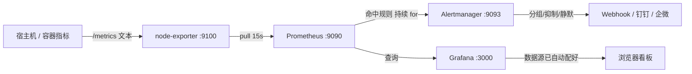

# docker-monitoring-stack · 一键部署监控栈

> 用 `docker compose up -d` 拉起 **Prometheus + Grafana + Node Exporter + Alertmanager**，
> 实现指标采集、可视化、告警判定与告警收敛的完整闭环。配置文件即代码，可版本管理。

## 为什么做这个

前面几个项目解决的是「单机、单点」的问题：巡检脚本只能看一台机器的一次快照，
日志分析只能事后翻。真正的生产环境需要的是**持续采集 + 长期存储 + 主动告警**。

这套栈是云原生监控的事实标准，也是很多公司运维/平台岗 JD 里的明确要求。

## 架构



**关键设计：Prometheus 是「拉」模型（pull），不是「推」。** 被监控端只需暴露一个
`/metrics` 接口，无需知道 Prometheus 在哪。新增监控目标只需加一条 `targets` 配置。

## 快速开始

```bash
docker compose up -d        # 启动
docker compose ps           # 看状态
docker compose logs -f prometheus
docker compose down         # 停止（数据卷保留）
docker compose down -v      # 连数据一起清掉
```

| 服务 | 地址 | 说明 |
| --- | --- | --- |
| Grafana | http://localhost:3000 | 账号 `admin` / `admin123`，数据源已自动配好 |
| Prometheus | http://localhost:9090 | 可查指标、看告警规则是否生效 |
| Alertmanager | http://localhost:9093 | 看告警分组与静默 |
| Node Exporter | http://localhost:9100/metrics | 原始指标文本 |

## 看板（Grafana）

Grafana 的数据源已通过 `grafana/provisioning/datasources/datasource.yml` 自动配好。
导入官方 **Node Exporter Full** 看板即可看到 CPU / 内存 / 磁盘 / 网络：

> Grafana → 左侧 `+` → Import → 填 `1860` → 选 Prometheus 数据源 → Load

（进阶：把自定义看板 JSON 放到 `grafana/provisioning/dashboards/` 并补一个 dashboards provider，
即可在容器启动时自动导入；参考 `grafana/provisioning/datasources/datasource.yml` 的写法。）

## 预置的告警规则

| 规则 | 表达式要点 | 持续时长 | 级别 |
| --- | --- | --- | --- |
| `HighCPUUsage` | 用 `rate(...[5m])` 算 5 分钟平均空闲率的反值 | 5m | warning |
| `HighMemoryUsage` | `MemAvailable / MemTotal` 求反 | 5m | warning |
| `DiskWillFillIn4Hours` | `predict_linear()` 按 1 小时增速**预测** 4 小时后是否写满 | 10m | critical |
| `DiskSpaceLow` | 已用百分比 > 85% | 10m | warning |
| `NodeDown` | `up == 0`，目标失联 | 1m | critical |
| `HighLoadAverage` | 5 分钟负载 > CPU 核数 × 2 | 10m | warning |

**`DiskWillFillIn4Hours` 是这套规则里最有价值的一条**：其他规则都是「已经出问题了才报」，
它是**在问题发生前预警**——按当前写入速度推算，4 小时后磁盘会满，现在就告诉你。

## 设计取舍

**① 为什么每个规则都有 `for`？**
```yaml
for: 5m
```
表示条件**连续满足 5 分钟**才真正触发告警。没有 `for`，CPU 跑个定时任务瞬间冲到 90% 就会告警，
然后 1 秒后恢复——这种抖动会造成告警疲劳，最后真出事时没人看。`for` 是抗抖动的关键。

**② Alertmanager 为什么要分组和抑制？**
- **分组**（`group_by`）：100 台机器的磁盘告警合并成 1 条消息，而不是 100 条
- **抑制**（`inhibit_rules`）：一台机器宕机时，抑制这台机器上的其他告警——
  机器都挂了，再报「CPU 高」「磁盘满」是噪音，根本原因只有「宕机」一条

**③ 数据只留 15 天**
```yaml
'--storage.tsdb.retention.time=15d'
```
磁盘是有限的。监控数据的价值随时间快速衰减，排查问题通常看最近几天。
长期趋势应另做降采样聚合（如 Thanos 或 recording rules）。

## 加 cAdvisor 监控容器自身

想监控「容器自身」的资源占用，在 `docker-compose.yml` 末尾追加以下服务，
并在 `prometheus/prometheus.yml` 取消 `cadvisor` job 的注释即可：

```yaml
  cadvisor:
    image: gcr.io/cadvisor/cadvisor:v0.49.1
    container_name: cadvisor
    restart: unless-stopped
    volumes:
      - /:/rootfs:ro
      - /var/run:/var/run:ro
      - /sys:/sys:ro
      - /var/lib/docker/:/var/lib/docker:ro
    ports:
      - "8080:8080"
```

## 目录结构

```
docker-monitoring-stack/
├── docker-compose.yml                          # 四个服务编排
├── prometheus/
│   ├── prometheus.yml                          # 拉取目标配置（含 cadvisor 注释段）
│   └── alert_rules.yml                         # 告警规则
├── alertmanager/alertmanager.yml               # 分组/抑制/静默
├── grafana/provisioning/
│   └── datasources/datasource.yml              # 数据源自动配置
├── docs/讲解文档.md
└── README.md
```

## 后续可做

- [ ] 接入钉钉 / 企业微信 webhook，让告警真正发出去（改 `alertmanager.yml` 的 receiver）
- [ ] 加黑盒探针（blackbox_exporter）：监控外部 URL 是否可访问
- [ ] 用 recording rules 预计算常用指标，加速大屏查询

## License

MIT © 沈炜丹 (swdscsc)
